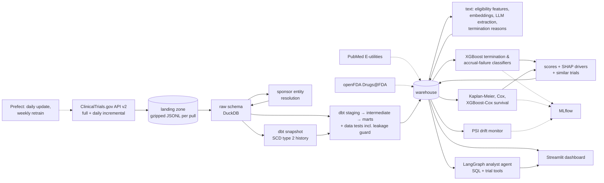
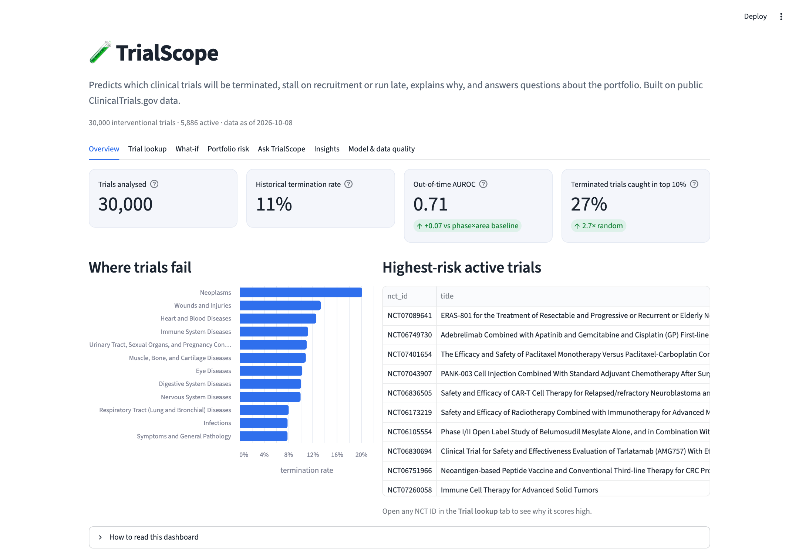
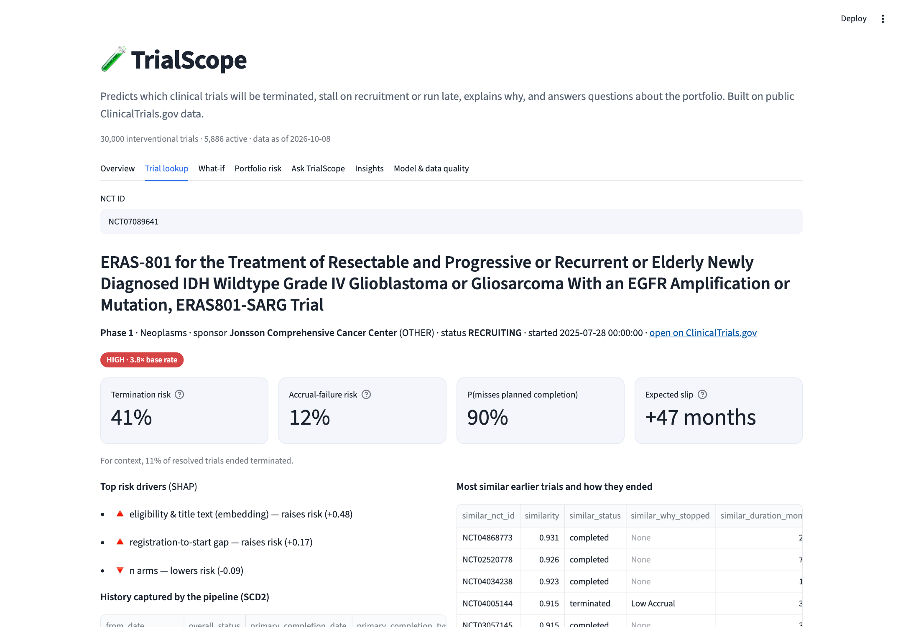
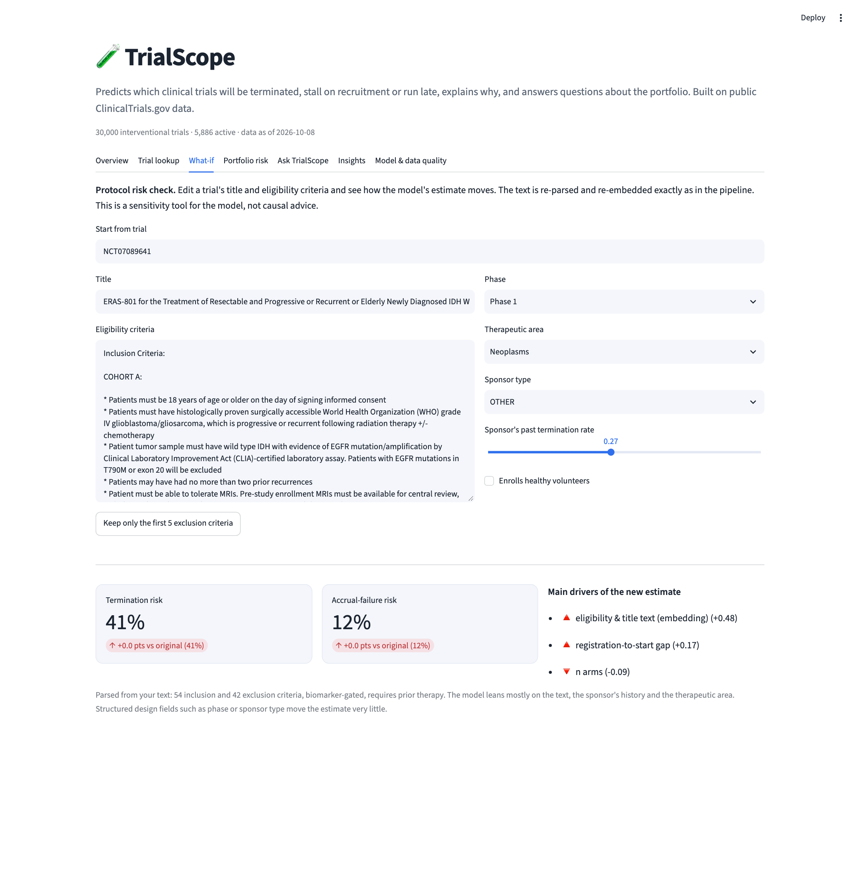
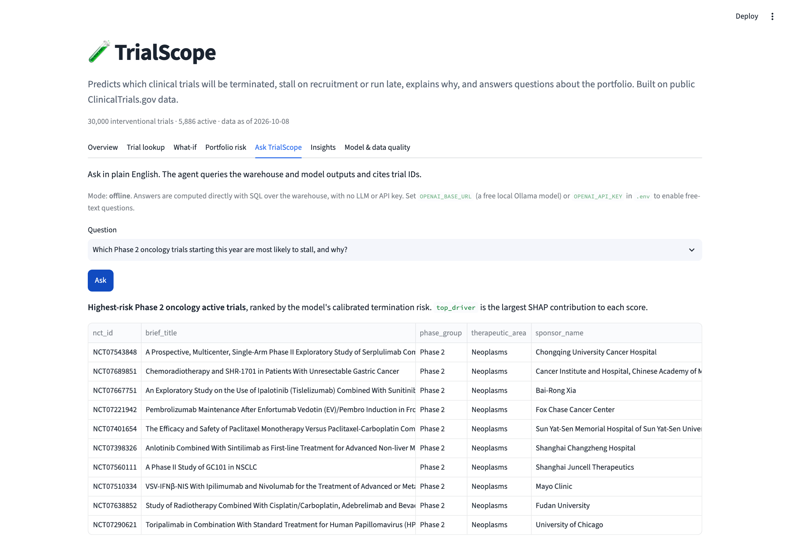
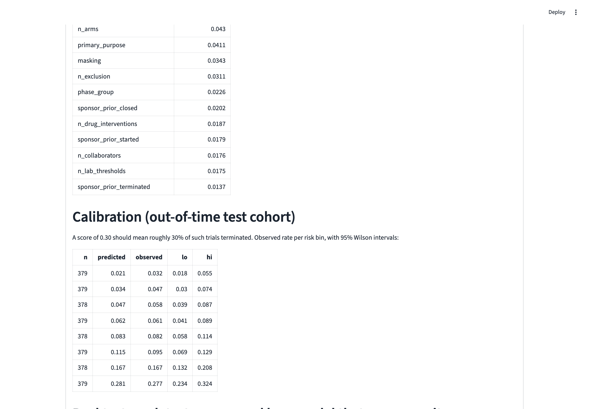

# TrialScope — predicting clinical-trial failure and delays

TrialScope predicts whether an interventional clinical trial will be **terminated early**, **fail to
recruit**, or **miss its planned completion date**. It explains each prediction and answers
plain-English questions over the data, such as *"Which Phase 2 oncology trials starting this year are most
likely to stall, and why?"* It is built end to end on public ClinicalTrials.gov data, enriched with PubMed
and openFDA.

**Stack:** Python · DuckDB · dbt · Prefect · XGBoost · lifelines · scikit-learn · MLflow · LangGraph · Ollama / OpenAI · Streamlit



## What you get



| | |
|---|---|
|  |  |
| **Trial lookup:** risk, SHAP drivers, similar earlier trials and how they ended, SCD2 history | **Protocol risk check:** edit a trial's eligibility text and watch the estimate move |
|  |  |
| **Ask TrialScope:** free-text agent with a local model, or SQL answers with no LLM at all | **Calibration:** predicted risk vs what happened to 2017-2019 trials the model never saw |

## Headline results

Real ClinicalTrials.gov data: 30,000 interventional trials, 10,597 resolved trials started 2008-2019 (10.8% terminated).
Train on trials started up to 2015, validate on 2016, test on 2017-2019. Only information known **at the trial's start** is used.

| | Result |
|---|---|
| Termination AUROC (XGBoost / logistic / phase×area baseline) | **0.712** / 0.656 / 0.644 |
| Terminated trials caught in the top 10% / 20% of risk at launch | **27.1%** / 46.8% (random would be 10% / 20%) |
| Per-year backtest AUROC (2017 / 2018 / 2019) | 0.708 / 0.741 / 0.690 |
| Calibration (Brier, lower is better) | 0.086, vs 0.089 for the phase×area baseline |
| **Same model with post-start fields (leakage ablation)** | **0.821 AUROC**, which is what a leaky pipeline would claim |
| Accrual-failure AUROC (XGBoost / logistic / baseline) | 0.748 / 0.686 / 0.680 |
| Time-to-completion C-index (XGBoost-Cox / Cox / phase only) | 0.727 / 0.633 / 0.573 |
| Free local analyst agent (Qwen2.5-7B via Ollama) | **83%** (10 of 12 SQL-verifiable questions), 0 invented trial IDs, $0, median 14 s. Count / rate / lookup 100%, "highest-risk trial" 1 of 3. With only 12 questions it is noisy (earlier prompt revisions scored 50-83%) |

The model is useful for **ranking** (it concentrates failures into the top of the list) but is not a crystal ball: termination is rare
and hard to call from start-time information alone. It is weakest for Phase 3/4 and for metabolic and mental-health trials
(see the slice table in `results/classifier_report.md`). A split-conformal check confirms the 90% coverage guarantee holds but also
shows that, with a ~10% base rate, the prediction sets are rarely informative. The calibrated probability and the ranking carry the signal.
`docs/leakage-writeup.md` explains the leakage finding.

## Quick start

Everything below is **free**: public data, local models, no API key required.

```bash
python3 -m venv .venv && source .venv/bin/activate        # Windows: .venv\Scripts\activate
pip install -r requirements-pipeline.txt                  # dashboard-only install: requirements.txt
cp .env.example .env                                      # Windows: copy .env.example .env

python run_pipeline.py --limit 30000        # real data, quick subset (~10 min). Full history: drop --limit (~30-60 min)
streamlit run app.py                        # dashboard at http://localhost:8501
```

Just want to look around? The repo ships a slim `deploy/` bundle, so after `pip install -r requirements.txt`,
`streamlit run app.py` works with **no pipeline run** (it falls back to the bundle when there is no warehouse).
`python run_pipeline.py --demo` builds a synthetic dataset in about 2 minutes. Never report numbers from it.

Stop the dashboard before re-running the pipeline (DuckDB allows one writer). Delete `warehouse/`, `data/landing/`, `models/`
and `results/` to switch between demo and real data, or demo rows get mixed into the real warehouse.

**Free LLM agent.** Install [Ollama](https://ollama.com), then `ollama pull qwen2.5:7b-instruct` and add to `.env`:

```
OPENAI_BASE_URL=http://localhost:11434/v1
CHAT_MODEL=qwen2.5:7b-instruct
```

The Ask tab, `python -m trialscope.agent "..."` and `python -m trialscope.agent_eval` then run on your machine. Without any LLM
configured, the Ask tab answers its example questions with SQL.

**Other ways to run it**

| | |
|---|---|
| Docker | `docker compose up` (dashboard from the bundle) · `docker compose run --rm pipeline` (full pipeline) |
| Free hosting | Push to GitHub, then on [share.streamlit.io](https://share.streamlit.io) choose the repo and `app.py`. It installs `requirements.txt` and runs from `deploy/`. |
| Refresh the bundle | `python scripts/make_deploy_bundle.py` after a pipeline run |
| Daily updates | `python run_pipeline.py --incremental`, or `python flows/daily_flow.py --serve` (Prefect) |
| Tests | `pytest -q` (26 offline tests, about 40 s, including a dashboard smoke test) |

## What the public data can and can't tell you (read this first)

| Problem | What TrialScope does |
|---|---|
| The v2 API serves **only the current version** of each record. There is no history endpoint. | Every pull is kept immutable, and a **dbt snapshot (SCD type 2)** records each change (status, dates, enrollment, sites). `dbt_valid_from` is the registry's own update date. This is the only way to see plans change. |
| When a trial ends, **planned values are overwritten with actuals.** Enrollment becomes ACTUAL, site lists become final, results get posted. | A **feature registry** marks each feature as known or not known at start. The model uses start-time features only. A **leakage ablation** retrains with the post-start fields to show how much they inflate scores. |
| Planned completion dates are overwritten too, so "how late was it vs plan" isn't available for historical trials. | Delay is modelled as **survival** (time to primary completion, with censoring). For active trials, the model estimates P(missing the date currently planned). The SCD2 history counts slips going forward (`n_completion_slips`). |
| Sponsor track record is easy to leak (counting outcomes that happened after the trial started). | Counted **as of each trial's start**, over a **5-year trailing window**, with DuckDB ASOF joins. A dbt test recomputes it by brute force. All-time counts were dropped because the drift monitor flagged them as non-stationary. |
| Recently started trials that have already ended are mostly the ones that stopped early. | The out-of-time test uses cohorts that are mostly resolved (2017–2019 by default). The report prints the resolution share by start year to justify this. |

## Data engineering

- **Ingestion** (`trialscope/ingest/ctgov.py`): paginated v2 client with field projection, retries and backoff. Full pulls are resumable. Incremental pulls use `AREA[LastUpdatePostDate]RANGE[...]` with a 3-day overlap. If the API rejects the field list, it falls back to all fields.
- **Load** (`ingest/load.py`): JSON is flattened into `raw.*` tables (studies, conditions, MeSH terms, browse branches, interventions, sites, references). The load is an idempotent upsert, and re-running it is a no-op.
- **Entity resolution** (`entity.py`): rules (case, punctuation, initialisms, legal suffixes), a curated alias table, then rapidfuzz fuzzy merging blocked by first token. On `labels/sponsor_gold.csv` the rules alone score pairwise precision 1.00 and recall 0.74; the aliases bring recall to 1.00. Aliases overlap the gold set, so quote the rules-only number. Therapeutic areas come from the MeSH branches ClinicalTrials.gov derives. The live API no longer returns them, so they are rebuilt from the MeSH ancestor terms, then from condition keywords for the ~1 in 5 trials with no MeSH data. The `is_rare_disease` flag is a **proxy** (inherited / inborn-error MeSH categories), not the official NIH list. On real data names collapse 8,667 → 8,584 sponsors; the merge rules matter far more on the messier synthetic set.
- **dbt** (`dbt/`): staging → intermediate → marts (`fct_trials`, `dim_sponsors`, `mart_area_phase_stats`). Also the SCD2 snapshot, schema tests (unique, not-null, accepted values, relationships), source freshness, and three singular tests: the brute-force leakage guard, one current version per trial, and negative durations (as a warning). `python -m trialscope.dbt_runner docs` builds dbt docs.
- **Orchestration** (`flows/daily_flow.py`): a daily Prefect flow (incremental download → dbt build → rescore → drift) and a weekly retrain. A failing data test stops the flow.
- **Enrichment** (`ingest/enrich.py`, optional):
  - **PubMed:** publications citing each NCT ID, batched esearch/efetch. This is an outcome signal, never a feature.
  - **openFDA:** first approval date per drug. The feature `drug_previously_approved` uses the approval date before trial start, so it is leakage-safe.

## Data science & ML

- **Classifiers** (`models/classifier.py`): XGBoost for terminated-vs-completed and for accrual failure (terminated for low enrollment).
  - Out-of-time split: train ≤ 2015, validate on 2016 (early stopping + Platt calibration; isotonic regression saturated at "99% risk" on a 1,000-trial validation year), test on 2017–2019.
  - Compared with a phase × area historical rate, a logistic regression, and the model without text features.
  - Metrics: AUROC, AUPRC, Brier, and **the share of eventually terminated trials flagged in the top 10% / 20% of risk at launch.**
- **Survival** (`models/survival.py`):
  - Kaplan-Meier curves by phase and area.
  - A Cox PH model with a hazard-ratio table, and a gradient-boosted Cox model (XGBoost `survival:cox`).
  - Out-of-time C-index against a phase-only baseline.
  - P(late) and expected slip for active trials.
- **Text** (`text/`):
  - Rule features from eligibility criteria: criteria counts, biomarker gating, prior-therapy requirement, ECOG, brain-mets exclusion, lab thresholds.
  - Text embeddings: TF-IDF+SVD fitted on the training years only, or OpenAI. The fitted embedder is saved, so the dashboard can embed new text.
  - LLM structured extraction, scored against your hand labels.
  - Termination reasons: negation-aware rules, an optional LLM classifier, and TF-IDF+k-means topics.
- **Explanations:** per-trial TreeSHAP drivers, plus global drivers grouped back to readable names.
- **Similar trials:** cosine kNN over text embedding + phase + area. It only returns trials that **started earlier**, so the comparison is what was knowable at the time.
- **Drift** (`models/drift.py`): PSI per feature and for the model score (training cohort vs the last 24 months). Logged to MLflow every run.
- **MLflow:** every training, survival and drift run. View with `mlflow ui --backend-store-uri sqlite:///mlflow.db`.

## LLM components and how they're evaluated

| Component | Evaluation |
|---|---|
| Eligibility extraction (`text/llm_extract.py`) | Label ~50 trials with `python -m trialscope.text.label eligibility --n 50`. You only see the text, never a model's answer. Then `llm_extract run --n 300` and `llm_extract eval` report per-field accuracy, rules vs LLM, and the cost per 1,000 trials. |
| Termination reasons (`text/termination.py --llm`) | Label ~100 with `python -m trialscope.text.label reasons --n 100`. Rule and LLM accuracy appear in `results/termination_reasons.md`. |
| Analyst agent (`agent.py`) | Runs on OpenAI **or a free local Ollama model**. `python -m trialscope.agent_eval`: count, rate, top-risk and lookup questions whose answers are computed with SQL. Reports accuracy, **answers containing NCT IDs no tool returned (hallucinated citations)**, tool calls, latency and cost. |

The agent's SQL tool is read-only (read-only connection, plus a guard that allows a single SELECT on `marts.*` / `ml.*`, with no file functions), and results are capped at 50 rows.

## More outputs

- **Evaluation extras** in `results/classifier_report.md`: calibration with Wilson intervals, per-year backtest, performance by sponsor type / phase / area, and split-conformal coverage.
- **Weekly watchlist** (`python -m trialscope.watchlist` → `results/watchlist.md`): the 15 highest-risk recently started active trials and which are new since the last run. It runs in the Prefect daily flow.
- **Protocol risk check** (What-if tab): re-parses and re-embeds edited eligibility text with the saved embedder and re-scores it. The structured design fields (phase, sponsor type, arms) barely move the estimate; the text, the sponsor's history and the area carry the signal.

## Demo video (2 minutes)

1. 0:00 The problem: trials that fail or drag on cost sponsors billions. Show the dashboard header.
2. 0:20 Trial lookup: risk, drivers, similar earlier trials and how they ended, and the SCD2 history.
3. 0:50 What-if tab: trim the exclusion criteria and watch the estimate and its drivers change.
4. 1:10 Ask tab: the stall question. Point at the cited NCT IDs.
5. 1:30 Model tab: out-of-time results and the leakage ablation ("this is what a leaky pipeline would claim").
6. 1:50 The most surprising finding.

## Project layout

```
trialscope/ingest/   ctgov.py (API client) · parse.py · load.py · enrich.py (PubMed, openFDA)
trialscope/          entity.py · dbt_runner.py · db.py · features.py · insights.py · watchlist.py · agent.py · agent_eval.py · llm.py · demo_data.py
trialscope/text/     eligibility.py · llm_extract.py · termination.py · label.py
trialscope/models/   classifier.py · calibration.py · survival.py · score.py · drift.py
dbt/                 sources, staging, intermediate, marts, snapshots, tests
flows/daily_flow.py  Prefect orchestration
app.py               Streamlit dashboard (Overview, lookup, what-if, portfolio, ask, insights, model quality)
deploy/              slim data + model bundle the hosted dashboard runs on (scripts/make_deploy_bundle.py)
docs/                screenshots and the leakage write-up
Dockerfile · docker-compose.yml · .github/workflows/ci.yml
labels/              sponsor alias + gold sets; your hand labels go here
tests/               offline end-to-end tests (API mocked, LLMs scripted)
```

## Limitations

- Terminated trials are censored in the survival model. That is a competing-risks simplification, so P(late) is "if it isn't stopped first".
- Eligibility text and collaborator lists may be amended after start. This is flagged in the registry, and the SCD2 history removes the problem for trials tracked from registration onward.
- Registry data has entry errors (negative durations, wrong statuses). They are surfaced by dbt warnings and excluded from modelling.
- The agent's free local model is slower and less reliable than a hosted one (see the evaluation numbers above).
- "UNKNOWN" status trials (not verified in 2+ years) are excluded from labels. Treating them as failures is a defensible alternative worth trying.
