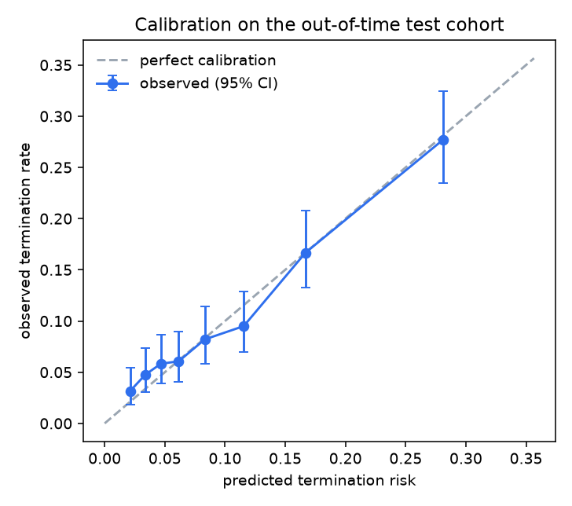

# Out-of-time classifier report

Train 2008-2015 (n=6,528), validation 2016-2016 (n=1,011), test 2017-2019 (n=3,029, termination rate 10.2%). Only features known at each trial's start are used.

## Termination (terminated vs completed)

| Model | AUROC | AUPRC | Brier | Terminated trials flagged in top 10% | in top 20% |
|---|---|---|---|---|---|
| xgboost | 0.712 | 0.221 | 0.086 | 27.1% | 46.8% |
| phase_x_area_rate | 0.644 | 0.192 | 0.089 | 24.8% | 42.6% |
| logistic_structured | 0.656 | 0.203 | 0.088 | 23.9% | 37.4% |
| xgboost_no_text | 0.710 | 0.234 | 0.086 | 26.8% | 42.9% |
| xgboost_WITH_LEAKY_FEATURES | 0.821 | 0.480 | 0.129 | 49.4% | 63.9% |

`xgboost_WITH_LEAKY_FEATURES` adds post-start fields (actual enrollment, final site count, results posted...). Its inflated score is what a leaky pipeline would report; top drivers of that leaky model: `eligibility & title text (embedding)`, `LEAK:enrollment_count`, `days_registration_to_start`, `intervention_model`, `phase_group`.

## Accrual failure (terminated for low enrollment vs completed)

| Model | AUROC | AUPRC | Brier | Terminated trials flagged in top 10% | in top 20% |
|---|---|---|---|---|---|
| xgboost | 0.748 | 0.118 | 0.024 | 40.6% | 49.3% |
| phase_x_area_rate | 0.680 | 0.072 | 0.024 | 37.7% | 53.6% |
| logistic_structured | 0.686 | 0.096 | 0.024 | 36.2% | 49.3% |

## Top risk drivers (mean |SHAP|, test cohort)

|                                      |   mean_abs_shap |
|:-------------------------------------|----------------:|
| eligibility & title text (embedding) |          1.4705 |
| days_registration_to_start           |          0.2034 |
| elig_chars                           |          0.0875 |
| healthy_volunteers                   |          0.0772 |
| n_arms                               |          0.043  |
| primary_purpose                      |          0.0411 |
| masking                              |          0.0343 |
| n_exclusion                          |          0.0311 |
| phase_group                          |          0.0226 |
| sponsor_prior_closed                 |          0.0202 |
| n_drug_interventions                 |          0.0187 |
| sponsor_prior_started                |          0.0179 |
| n_collaborators                      |          0.0176 |
| n_lab_thresholds                     |          0.0175 |
| sponsor_prior_terminated             |          0.0137 |

## Calibration (out-of-time test cohort)

A score of 0.30 should mean roughly 30% of such trials terminated. Observed rate per risk bin, with 95% Wilson intervals:

|   n |   predicted |   observed |    lo |    hi |
|----:|------------:|-----------:|------:|------:|
| 379 |       0.021 |      0.032 | 0.018 | 0.055 |
| 379 |       0.034 |      0.047 | 0.03  | 0.074 |
| 378 |       0.047 |      0.058 | 0.039 | 0.087 |
| 379 |       0.062 |      0.061 | 0.041 | 0.089 |
| 378 |       0.083 |      0.082 | 0.058 | 0.114 |
| 379 |       0.115 |      0.095 | 0.069 | 0.129 |
| 378 |       0.167 |      0.167 | 0.132 | 0.208 |
| 379 |       0.281 |      0.277 | 0.234 | 0.324 |

## Backtest: each test year scored by a model that never saw it

| Start year | n | termination rate | AUROC | terminated trials caught in top 10% |
|---|---|---|---|---|
| 2017 | 994 | 10.4% | 0.708 | 27.2% |
| 2018 | 1035 | 10.3% | 0.741 | 29.9% |
| 2019 | 1000 | 10.0% | 0.690 | 27.0% |

## Performance by slice (where is the model weaker?)

| sponsor_class   |    n |   termination_rate |   auroc |
|:----------------|-----:|-------------------:|--------:|
| OTHER           | 2120 |              0.087 |   0.708 |
| INDUSTRY        |  777 |              0.151 |   0.688 |

| phase_group    |    n |   termination_rate |   auroc |
|:---------------|-----:|-------------------:|--------:|
| Not applicable | 1799 |              0.067 |   0.67  |
| Phase 2        |  358 |              0.201 |   0.681 |
| Phase 1        |  349 |              0.138 |   0.766 |
| Phase 4        |  198 |              0.086 |   0.484 |
| Phase 3        |  190 |              0.137 |   0.566 |

| therapeutic_area                   |   n |   termination_rate |   auroc |
|:-----------------------------------|----:|-------------------:|--------:|
| Neoplasms                          | 494 |              0.221 |   0.67  |
| Other / unspecified                | 492 |              0.053 |   0.668 |
| Heart and Blood Diseases           | 306 |              0.111 |   0.636 |
| Nervous System Diseases            | 294 |              0.085 |   0.635 |
| Behaviors and Mental Disorders     | 224 |              0.058 |   0.563 |
| Nutritional and Metabolic Diseases | 211 |              0.095 |   0.495 |

## Uncertainty: split-conformal prediction sets

Targeting 90% coverage. Empirical coverage on the test cohort: **90.4%**. The model commits to one label for 97.5% of trials (0.0% 'will terminate', 97.5% 'will complete') and abstains (2.5% 'could be either', 0.0% empty) on the rest. With a ~10% base rate and start-time information only, a 90%-coverage set almost always contains just 'completed': the guarantee holds, but the sets are not informative here. The calibrated probability and the ranking carry the signal.

## Why recent start years are not used for testing

Trials that started recently and already ended are disproportionately the ones that stopped early, so evaluating on them would be biased. Share of trials resolved by start year:

|   start_year |    n |   resolved_share | termination_rate_among_resolved   |
|-------------:|-----:|-----------------:|:----------------------------------|
|         2019 | 1517 |            0.659 | 0.1                               |
|         2020 | 1605 |            0.617 | 0.125                             |
|         2021 | 1937 |            0.594 | 0.096                             |
|         2022 | 1789 |            0.554 | 0.08                              |
|         2023 | 2025 |            0.46  | 0.073                             |
|         2024 | 2051 |            0.326 | 0.046                             |
|         2025 | 2035 |            0.225 | 0.028                             |
|         2026 | 1840 |            0.058 | 0.019                             |
|         2027 |   82 |            0     | <NA>                              |
|         2028 |    5 |            0     | <NA>                              |
|         2029 |    1 |            0     | <NA>                              |
|         2030 |    1 |            0     | <NA>                              |
