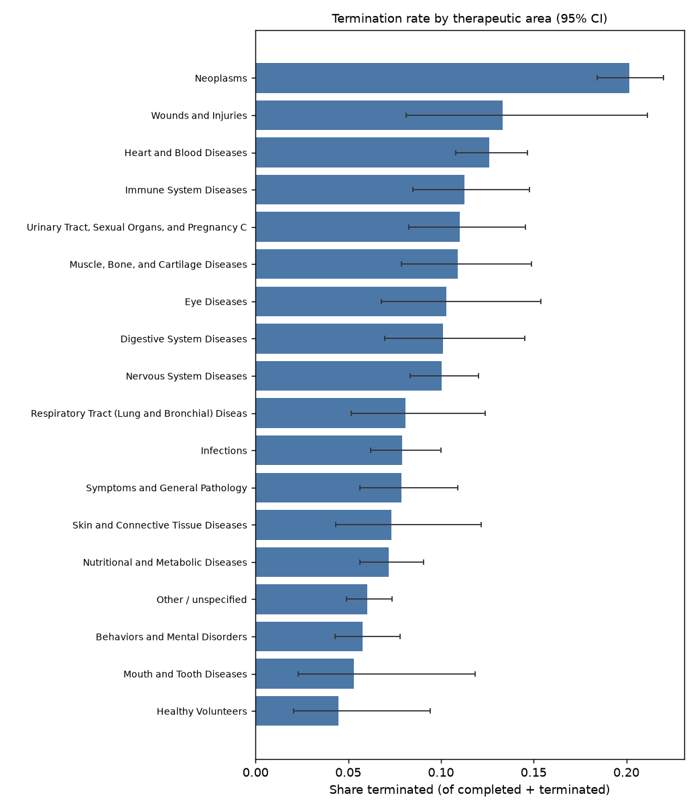
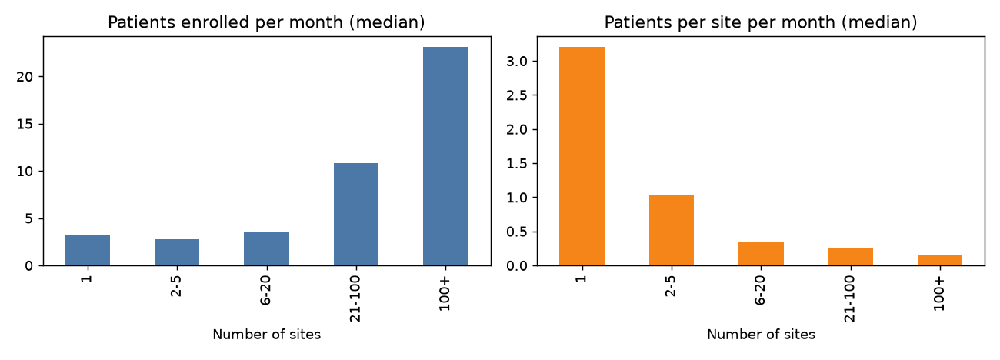

# TrialScope findings

10,597 resolved interventional trials started 2008-2019 (overall termination rate 10.8%).

## 1. Termination by therapeutic area

| therapeutic_area                                       |    n |   termination_rate |   ci_low |   ci_high |
|:-------------------------------------------------------|-----:|-------------------:|---------:|----------:|
| Neoplasms                                              | 1925 |              0.202 |    0.184 |     0.22  |
| Wounds and Injuries                                    |  105 |              0.133 |    0.081 |     0.211 |
| Heart and Blood Diseases                               | 1126 |              0.126 |    0.108 |     0.147 |
| Immune System Diseases                                 |  391 |              0.113 |    0.085 |     0.148 |
| Urinary Tract, Sexual Organs, and Pregnancy Conditions |  381 |              0.11  |    0.083 |     0.146 |
| Muscle, Bone, and Cartilage Diseases                   |  303 |              0.109 |    0.079 |     0.149 |
| Eye Diseases                                           |  194 |              0.103 |    0.068 |     0.154 |
| Digestive System Diseases                              |  247 |              0.101 |    0.07  |     0.145 |
| Nervous System Diseases                                | 1007 |              0.1   |    0.083 |     0.12  |
| Respiratory Tract (Lung and Bronchial) Diseases        |  223 |              0.081 |    0.052 |     0.124 |
| Infections                                             |  773 |              0.079 |    0.062 |     0.1   |
| Symptoms and General Pathology                         |  406 |              0.079 |    0.056 |     0.109 |
| Skin and Connective Tissue Diseases                    |  177 |              0.073 |    0.043 |     0.122 |
| Nutritional and Metabolic Diseases                     |  879 |              0.072 |    0.056 |     0.091 |
| Other / unspecified                                    | 1478 |              0.06  |    0.049 |     0.074 |
| Behaviors and Mental Disorders                         |  691 |              0.058 |    0.043 |     0.078 |
| Mouth and Tooth Diseases                               |   94 |              0.053 |    0.023 |     0.119 |
| Healthy Volunteers                                     |  134 |              0.045 |    0.021 |     0.094 |

Highest: **Neoplasms** (20.2%); lowest: **Healthy Volunteers** (4.5%).

### By phase x sponsor class

|                                 |    n |   termination_rate |   ci_low |   ci_high |
|:--------------------------------|-----:|-------------------:|---------:|----------:|
| ('Phase 1/2', 'INDUSTRY')       |  166 |              0.223 |    0.166 |     0.292 |
| ('Phase 2', 'OTHER')            |  751 |              0.198 |    0.171 |     0.228 |
| ('Phase 1/2', 'OTHER')          |  194 |              0.16  |    0.115 |     0.218 |
| ('Phase 2', 'INDUSTRY')         |  660 |              0.145 |    0.121 |     0.174 |
| ('Phase 1', 'OTHER')            |  556 |              0.144 |    0.117 |     0.176 |
| ('Phase 4', 'INDUSTRY')         |  196 |              0.143 |    0.101 |     0.199 |
| ('Phase 3', 'OTHER')            |  345 |              0.136 |    0.104 |     0.176 |
| ('Phase 2/3', 'OTHER')          |  123 |              0.13  |    0.082 |     0.201 |
| ('Not applicable', 'INDUSTRY')  |  534 |              0.124 |    0.098 |     0.154 |
| ('Phase 4', 'OTHER')            |  732 |              0.117 |    0.096 |     0.143 |
| ('Not applicable', 'FED')       |   90 |              0.111 |    0.061 |     0.193 |
| ('Phase 3', 'INDUSTRY')         |  588 |              0.111 |    0.088 |     0.138 |
| ('Phase 1', 'INDUSTRY')         |  882 |              0.079 |    0.063 |     0.099 |
| ('Not applicable', 'OTHER')     | 4306 |              0.072 |    0.065 |     0.08  |
| ('Not applicable', 'OTHER_GOV') |  137 |              0.022 |    0.007 |     0.062 |

## 2. Do more sites recruit faster?

| sites   |    n |   median_patients_per_month |   median_patients_per_site_month |   median_months |
|:--------|-----:|----------------------------:|---------------------------------:|----------------:|
| 1       | 5669 |                        3.2  |                             3.2  |           19.02 |
| 2-5     | 1224 |                        2.75 |                             1.04 |           24.56 |
| 6-20    |  767 |                        3.61 |                             0.34 |           28.02 |
| 21-100  |  544 |                       10.86 |                             0.25 |           24.62 |
| 100+    |  109 |                       23.08 |                             0.16 |           34.07 |

Total enrollment speed vs per-site productivity. Final site counts are only known after the fact, so this is descriptive and the variable is excluded from the predictive model.

## 3. Sponsor track record (5 years before start, as of start date)

Sponsors with at least 5 closed trials in the window, grouped into quintiles of their past termination rate:

| track_record     |   n |   termination_rate |
|:-----------------|----:|-------------------:|
| (0.0431, 0.0862] | 631 |              0.097 |
| (0.0862, 0.1]    | 695 |              0.089 |
| (0.1, 0.139]     | 577 |              0.125 |
| (0.139, 0.175]   | 618 |              0.144 |
| (0.175, 0.411]   | 606 |              0.144 |

## 4. Rare-disease trials

| is_rare_disease   |     n |   termination_rate |   accrual_failure_rate |   median_months_to_completion |
|:------------------|------:|-------------------:|-----------------------:|------------------------------:|
| False             | 10312 |              0.108 |                  0.038 |                        19.974 |
| True              |   285 |              0.091 |                  0.011 |                        24.967 |

## 5. Why trials stop, by phase (share of terminated trials)

| phase_group    |   business |   covid |   efficacy |   enrollment |   funding |   logistics |   other |   regulatory |   safety |
|:---------------|-----------:|--------:|-----------:|-------------:|----------:|------------:|--------:|-------------:|---------:|
| Not applicable |      0.027 |   0.113 |      0.02  |        0.354 |     0.065 |       0.077 |   0.307 |        0.025 |    0.013 |
| Phase 1        |      0.218 |   0.034 |      0.067 |        0.265 |     0.063 |       0.059 |   0.239 |        0.021 |    0.034 |
| Phase 1/2      |      0.145 |   0.017 |      0.094 |        0.274 |     0.077 |       0.043 |   0.291 |        0.017 |    0.043 |
| Phase 2        |      0.089 |   0.033 |      0.109 |        0.399 |     0.043 |       0.036 |   0.209 |        0.005 |    0.076 |
| Phase 2/3      |      0.106 |   0.043 |      0.085 |        0.298 |     0.085 |       0.064 |   0.213 |        0.021 |    0.085 |
| Phase 3        |      0.148 |   0.021 |      0.19  |        0.317 |     0.021 |       0.005 |   0.222 |        0.026 |    0.048 |
| Phase 4        |      0.037 |   0.062 |      0.05  |        0.404 |     0.112 |       0.05  |   0.248 |        0.012 |    0.025 |

## Write-up prompt

Pick the result that surprised you most, check it against the raw data (open a few trials on clinicaltrials.gov), and write it up with the figure.
