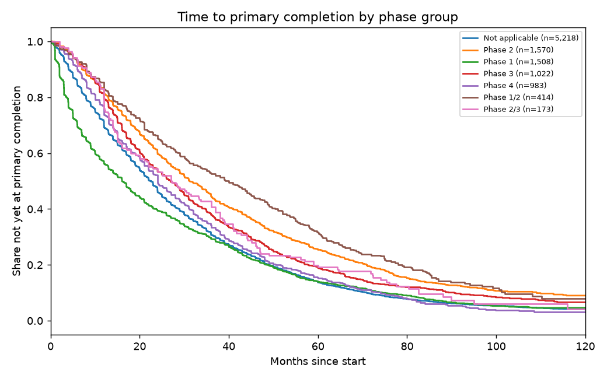
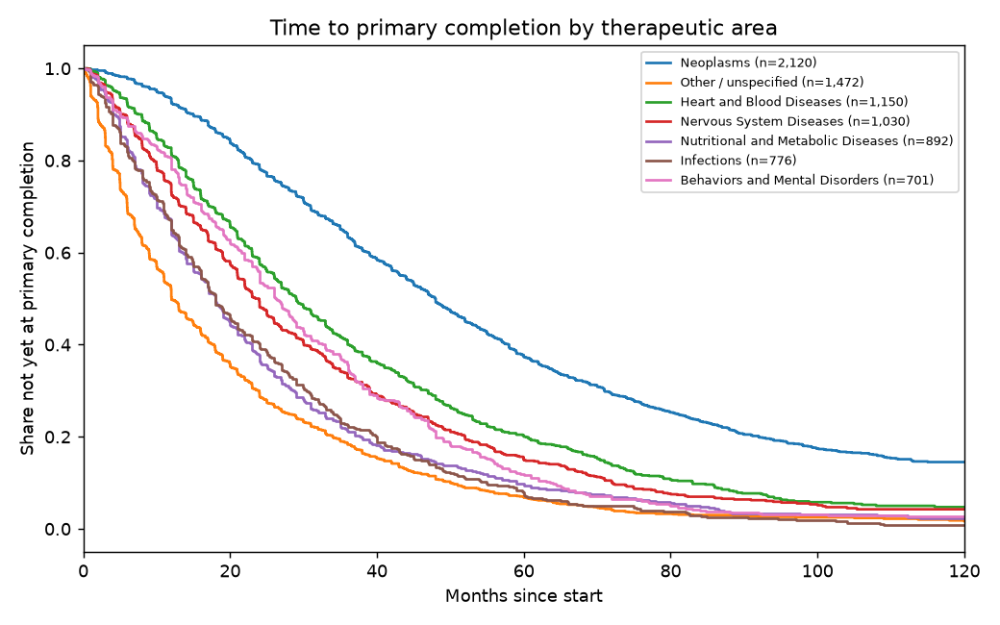

# Survival analysis: time to primary completion

Out-of-time concordance (test start years 2017-2019, n=3,268):

| Model | C-index |
|---|---|
| Phase only (Cox) | 0.573 |
| Cox PH, start-time covariates | 0.633 |
| Gradient-boosted Cox (XGBoost), all features | 0.727 |

Hazard ratio > 1 = reaches primary completion FASTER; < 1 = slower.

| covariate                                           |   hazard_ratio |   hr_lo |   hr_hi |     p |
|:----------------------------------------------------|---------------:|--------:|--------:|------:|
| phase_group=Phase 2                                 |          0.901 |   0.833 |   0.974 | 0.009 |
| phase_group=Phase 1                                 |          1.357 |   1.255 |   1.466 | 0     |
| phase_group=Phase 3                                 |          0.82  |   0.751 |   0.895 | 0     |
| phase_group=Phase 4                                 |          0.986 |   0.905 |   1.074 | 0.745 |
| phase_group=Phase 1/2                               |          0.766 |   0.669 |   0.876 | 0     |
| phase_group=Phase 2/3                               |          0.91  |   0.755 |   1.096 | 0.321 |
| sponsor_class=INDUSTRY                              |          1.926 |   1.815 |   2.045 | 0     |
| sponsor_class=OTHER_GOV                             |          1.025 |   0.858 |   1.226 | 0.785 |
| sponsor_class=NIH                                   |          0.807 |   0.645 |   1.009 | 0.06  |
| sponsor_class=FED                                   |          0.729 |   0.582 |   0.914 | 0.006 |
| sponsor_class=NETWORK                               |          0.621 |   0.468 |   0.823 | 0.001 |
| sponsor_class=INDIV                                 |          0.852 |   0.484 |   1.499 | 0.578 |
| therapeutic_area=Other / unspecified                |          1.931 |   1.785 |   2.089 | 0     |
| therapeutic_area=Heart and Blood Diseases           |          1.056 |   0.97  |   1.15  | 0.211 |
| therapeutic_area=Nervous System Diseases            |          1.262 |   1.156 |   1.379 | 0     |
| therapeutic_area=Nutritional and Metabolic Diseases |          1.651 |   1.51  |   1.805 | 0     |
| therapeutic_area=Infections                         |          1.734 |   1.577 |   1.907 | 0     |
| therapeutic_area=Behaviors and Mental Disorders     |          1.263 |   1.139 |   1.401 | 0     |
| therapeutic_area=Immune System Diseases             |          1.348 |   1.187 |   1.531 | 0     |
| is_rare_disease                                     |          0.83  |   0.717 |   0.96  | 0.012 |
| log_n_exclusion                                     |          0.911 |   0.883 |   0.94  | 0     |
| requires_biomarker                                  |          0.586 |   0.523 |   0.656 | 0     |
| sponsor_prior_term_rate                             |          0.082 |   0.042 |   0.16  | 0     |
| log_sponsor_prior_started                           |          0.94  |   0.921 |   0.96  | 0     |

## Median months to primary completion (Kaplan-Meier)

| group            | level                              |    n |   median_months_to_completion |
|:-----------------|:-----------------------------------|-----:|------------------------------:|
| phase_group      | Not applicable                     | 5218 |                          22.5 |
| phase_group      | Phase 2                            | 1570 |                          31.2 |
| phase_group      | Phase 1                            | 1508 |                          16   |
| phase_group      | Phase 3                            | 1022 |                          27   |
| phase_group      | Phase 4                            |  983 |                          24   |
| phase_group      | Phase 1/2                          |  414 |                          40   |
| phase_group      | Phase 2/3                          |  173 |                          27.1 |
| therapeutic_area | Neoplasms                          | 2120 |                          48   |
| therapeutic_area | Other / unspecified                | 1472 |                          12   |
| therapeutic_area | Heart and Blood Diseases           | 1150 |                          29   |
| therapeutic_area | Nervous System Diseases            | 1030 |                          23.9 |
| therapeutic_area | Nutritional and Metabolic Diseases |  892 |                          18   |
| therapeutic_area | Infections                         |  776 |                          18   |
| therapeutic_area | Behaviors and Mental Disorders     |  701 |                          26.2 |

